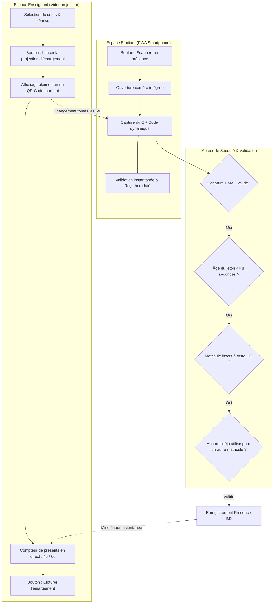

# Cahier des Charges & Guide d'Implémentation IA
## Système d'Émargement Sécurisé par QR Code Dynamique Tournant
**École Nationale Polytechnique de Lomé (ENP)**  
*Conception institutionnelle : Pr Adekunle Akim SALAMI, KOUDASSE Joy Amos & OHOUNSOUN Bienvenu*

---

## 1. Contexte & Vision

### 1.1 Problématique actuelle
L'émargement traditionnel sur feuille de présence papier présente des limites opérationnelles majeures dans les grandes promotions (50 à 300 étudiants) :
* Perte de 10 à 15 minutes au début de chaque cours.
* Fraude par complaisance (signatures pour des camarades absents).
* Tâche fastidieuse de ressaisie manuelle pour le délégué et la scolarité.

### 1.2 La solution : Le QR Code Dynamique Tournant (Rolling QR Code)
Le système permet à l'enseignant de projeter un QR code haute définition sur le tableau/vidéoprojecteur dès le début du cours. Les étudiants scannent ce QR code directement depuis l'application PWA installée sur leur smartphone.

Pour empêcher formellement toute transmission de photo sur WhatsApp ou les réseaux sociaux :
* Le QR code se régénère automatiquement toutes les **6 secondes**.
* Chaque QR code embarque un jeton cryptographique à courte durée de vie signé par le serveur (HMAC-SHA256).
* Une photo partagée sur WhatsApp expire avant que l'étudiant absent n'ait le temps de l'ouvrir et de la scanner.
* L'émargement complet d'un amphi de 150 étudiants est finalisé en moins de **120 secondes**.

---

## 2. Architecture Fonctionnelle & Acteurs



---

## 3. Spécifications Techniques & Règles Anti-Fraude

### 3.1 Structure du Jeton Éphémère (Rolling Token)
Le contenu textuel encodé dans le QR code projeté est une chaîne compacte chiffrée ou signée au format URL-safe :
```text
ENP-PRESENCE:v1.<seanceId>.<timestampMs>.<counter>.<signatureHmac>
```

* `seanceId` : Identifiant numérique de la séance de présence.
* `timestampMs` : Horodatage Unix en millisecondes de l'émission du QR code.
* `counter` : Numéro séquentiel incrémenté à chaque nouveau QR code (1, 2, 3...).
* `signatureHmac` : Signature HMAC-SHA256 calculée avec la clé secrète serveur `QR_PRESENCE_SECRET` sur la chaîne `seanceId:timestampMs:counter`.

### 3.2 Règles strictes de validation serveur
1. **Fenêtre de péremption stricte** :
   * L'écart entre l'heure de réception par le serveur et le `timestampMs` du jeton doit être inférieur ou égal à **8 000 ms** (6 secondes d'affichage + 2 secondes de tolérance de latence réseau).
   * Tout jeton au-delà de 8 secondes est rejeté avec l'erreur : *"QR Code expiré. Veuillez rescanner l'écran du professeur."*
2. **Unicité stricte de l'émargement** :
   * Un étudiant ne peut être marqué présent qu'une seule fois pour la même séance (`UNIQUE(seance_id, etudiant_id)`).
3. **Protection anti-téléphone partagé (Device Binding)** :
   * Le client transmet une empreinte anonymisée de l'appareil (Device Token stocké localement).
   * Si le même Device Token est utilisé pour émarger sous deux matricules différents pour la même séance, le deuxième scan est bloqué avec alerte : *"Cet appareil a déjà été utilisé pour un émargement pour cette séance."*
4. **Statut actif de la séance** :
   * Dès que l'enseignant clique sur *"Clôturer l'émargement"*, le statut de la séance passe à `fermee` dans la base de données. Tout scan ultérieur est rejeté.

---

## 4. Schéma de Données Recommandé (PostgreSQL)

```sql
-- Extension du module de présences
CREATE TABLE IF NOT EXISTS ref.seance_presence_session (
  id SERIAL PRIMARY KEY,
  seance_id INT NOT NULL REFERENCES ref.seance_presence(id) ON DELETE CASCADE,
  enseignant_id INT NOT NULL REFERENCES ref.user_account(id),
  statut VARCHAR(20) NOT NULL DEFAULT 'ouverte', -- 'ouverte', 'pause', 'fermee'
  session_secret VARCHAR(64) NOT NULL, -- Sel spécifique à la session
  ouvert_a TIMESTAMPTZ NOT NULL DEFAULT NOW(),
  ferme_a TIMESTAMPTZ,
  duree_validite_secondes INT NOT NULL DEFAULT 6
);

-- Journalisation fine des scans
CREATE TABLE IF NOT EXISTS ref.presence_scan_log (
  id BIGSERIAL PRIMARY KEY,
  seance_id INT NOT NULL REFERENCES ref.seance_presence(id),
  etudiant_id INT NOT NULL REFERENCES ref.user_account(id),
  scanne_a TIMESTAMPTZ NOT NULL DEFAULT NOW(),
  token_counter INT NOT NULL,
  token_age_ms INT NOT NULL,
  ip_address VARCHAR(45),
  device_fingerprint VARCHAR(64),
  statut VARCHAR(20) NOT NULL DEFAULT 'valide', -- 'valide', 'rejete_expire', 'rejete_doublon'
  CONSTRAINT uq_seance_etudiant UNIQUE (seance_id, etudiant_id)
);
```

---

## 5. Découpage en Lots & Prompts pour Agent IA

Voici la suite ordonnée de prompts que vous pouvez transmettre un par un à un agent IA pour exécuter l'implémentation complète sans erreur.

---

### Lot 1 : Moteur Cryptographique & Endpoints Backend (NestJS)

> **Prompt à copier pour l'agent IA :**
> 
> ```markdown
> Agis en tant qu'architecte backend senior NestJS / PostgreSQL pour la plateforme académique de l'ENP.
> 
> MISSION :
> Implémente le moteur backend du système d'émargement par QR Code Dynamique Tournant (Rolling QR Code).
> 
> SPÉCIFICATIONS :
> 1. Crée un utilitaire cryptographique `apps/api/src/cahier-texte/qr-presence-crypto.util.ts` :
>    - `genererJetonPresence(seanceId: number, counter: number, secretKey: string): { token: string; expireDansMs: number }`
>    - `validerJetonPresence(token: string, secretKey: string, maxAgeMs = 8000): { valide: boolean; seanceId?: number; erreur?: string }`
>    - Utilise le module natif `node:crypto` avec HMAC-SHA256.
> 
> 2. Ajoute les endpoints sécurisés dans `cahier-texte.controller.ts` :
>    - `POST /api/v1/presences/sessions/demarrer` (Rôle : `enseignant`) : initialise la session de projection, génère la graine secrète et retourne le premier jeton.
>    - `GET /api/v1/presences/sessions/:seanceId/jeton` (Rôle : `enseignant`) : fournit le jeton actuel avec compteur incrémenté.
>    - `POST /api/v1/presences/sessions/:seanceId/cloturer` (Rôle : `enseignant`) : clôture définitivement l'émargement.
>    - `POST /api/v1/presences/scanner` (Rôle : `etudiant`) : reçoit `{ token: string, deviceFingerprint: string }`, vérifie la signature et l'âge du jeton (<= 8s), enregistre l'émargement de l'étudiant connecté, et renvoie le statut confirmé.
> 
> 3. Écris les tests unitaires Jest correspondants pour tester l'expiration à 8 secondes, la signature invalide et la prévention du double scan.
> N'utilise aucun tiret cadratin dans les commentaires ou messages. Respecte le nom OHOUNSOUN Bienvenu.
> ```

---

### Lot 2 : Écran de Projection Enseignant (Mode Vidéoprojecteur)

> **Prompt à copier pour l'agent IA :**
> 
> ```markdown
> Agis en tant que développeur frontend React senior TailwindCSS pour la plateforme ENP.
> 
> MISSION :
> Développe l'interface plein écran de projection pour l'enseignant : `apps/web/src/pages/ProjectionPresence.tsx` (accessible depuis la page des présences).
> 
> SPÉCIFICATIONS :
> 1. Interface grand format optimisée pour vidéoprojecteur :
>    - Fond institutionnel sobre et contrasté (#0B2545 et blanc).
>    - En haut : Code et intitulé de l'UE (ex: INF201 Algorithmique), promotion, date et heure en grand format.
>    - Au centre : Affichage géant du QR Code dynamique (utilise `qrcode.react` ou générateur SVG natif sans dépendance externe lourde).
>    - Barre de progression animée de 6 secondes qui se vide pour indiquer le temps restant avant le prochain QR code.
>    - Effet de pulsation fluide lors du changement de QR code.
> 
> 2. Panneau latéral droit :
>    - Compteur géant en direct : Présents / Inscrits avec pourcentage.
>    - Flux défilant en direct des 5 derniers étudiants ayant scanné (Nom, Prénom, heure exacte HH:MM:SS avec animation d'apparition verte).
>    - Bouton d'action rouge proéminent : "Clôturer l'émargement" avec confirmation.
>    - Bouton pour passer en mode Plein Écran (API Fullscreen du navigateur).
> 
> 3. Gestion du flux temps réel :
>    - Polling régulier de 3 à 5 secondes ou EventSource pour rafraîchir le compteur des présents.
>    - Rafraîchissement automatique du QR code toutes les 6 secondes.
> 
> N'utilise aucun tiret cadratin. Assure-toi que la page est accessible sans conflit dans App.tsx pour le rôle enseignant.
> ```

---

### Lot 3 : Lecteur Caméra & Expérience de Scan Étudiant (PWA)

> **Prompt à copier pour l'agent IA :**
> 
> ```markdown
> Agis en tant que développeur frontend React et PWA mobile.
> 
> MISSION :
> Ajoute la capacité de scan de présence par caméra sur la page `apps/web/src/pages/EtudiantPresences.tsx`.
> 
> SPÉCIFICATIONS :
> 1. Ajoute un bouton d'action principal bien visible sur mobile :
>    - Intitulé : "Scanner ma présence en direct".
>    - Icône de caméra ou QR code avec badge institutionnel.
> 
> 2. Modale / Écran de scan intégré :
>    - Utilise l'API native `navigator.mediaDevices.getUserMedia({ video: { facingMode: 'environment' } })` avec un lecteur léger (ex: `@zxing/browser` ou `qr-scanner`).
>    - Viseur graphique carré centré avec ligne de balayage animée.
>    - Bouton pour allumer la torche/flash si supporté par le téléphone.
>    - Détection instantanée dès que le QR code entre dans le cadre.
> 
> 3. Retours utilisateurs (Feedback UX) :
>    - Vibration haptique immédiate (`navigator.vibrate(200)`).
>    - Écran de succès vert franc : "Présence validée pour INF201 à 08h05".
>    - Gestion claire des messages d'erreur :
>      * Si le QR code a plus de 6 secondes : "Ce code a expiré. Veuillez rescanner l'écran du tableau."
>      * Si l'étudiant a déjà émargé : "Vous avez déjà émargé pour cette séance."
>      * Si la séance est fermée : "L'émargement a été clôturé par l'enseignant."
> 
> 4. Teste la compatibilité iOS Safari et Android Chrome sur smartphone.
> Pas de tiret cadratin dans les textes.
> ```

---

### Lot 4 : Support Complet du Mode Démo / Maquette (`VITE_USE_MOCK=true`)

> **Prompt à copier pour l'agent IA :**
> 
> ```markdown
> Agis en tant qu'ingénieur frontend spécialisé dans le tooling de maquettage.
> 
> MISSION :
> Mets à jour `apps/web/src/api/mock.ts` pour que la fonctionnalité de QR Code Dynamique fonctionne à 100% en mode maquette (`VITE_USE_MOCK=true`), sans avoir besoin d'allumer le backend PostgreSQL.
> 
> SPÉCIFICATIONS :
> 1. Implémente dans `mock.ts` :
>    - Simulation de la session d'émargement pour les séances de cours.
>    - Génération de faux jetons HMAC tournants valides côté client.
>    - Simulation de l'arrivée progressive d'émargements virtuels toutes les 4 secondes pour que l'enseignant voie le compteur monter en direct lors d'une démonstration.
>    - Prise en charge du scan caméra : si l'étudiant scanne le QR code généré sur l'ordinateur en mode mock, valider instantanément la présence dans le state mocké.
> 2. Permets de tester l'intégralité du scénario avec deux onglets de navigateur ouverts (un en rôle Enseignant, un en rôle Étudiant).
> Pas de tiret cadratin.
> ```

---

## 6. Protocole de Recette & Vérification de Sécurité

| ID | Scénario de test | Comportement attendu |
| :--- | :--- | :--- |
| **TC-01** | Scan normal en amphi (< 4s après affichage) | Présence validée immédiatement, statut mis à jour en vert, compteur incrémenté. |
| **TC-02** | Scan après 9 secondes (tentative WhatsApp) | Rejet immédiat avec message : *« QR Code expiré »*. |
| **TC-03** | Scan d'un QR code falsifié ou modifié | Rejet par échec de la signature HMAC. |
| **TC-04** | Double émargement du même étudiant | Bloqué avec notification : *« Déjà émargé »*. |
| **TC-05** | Même téléphone utilisé pour deux matricules | Blocage du second scan via l'empreinte d'appareil. |
| **TC-06** | Scan après clôture par l'enseignant | Rejet : *« Émargement clôturé »*. |
| **TC-07** | Bascule plein écran enseignant (F11 / Plein écran) | Adaptation responsive parfaite 16:9 et 16:10. |

---
*Ce document sert de spécification de référence pour l'implémentation complète du système d'émargement à l'ENP.*
